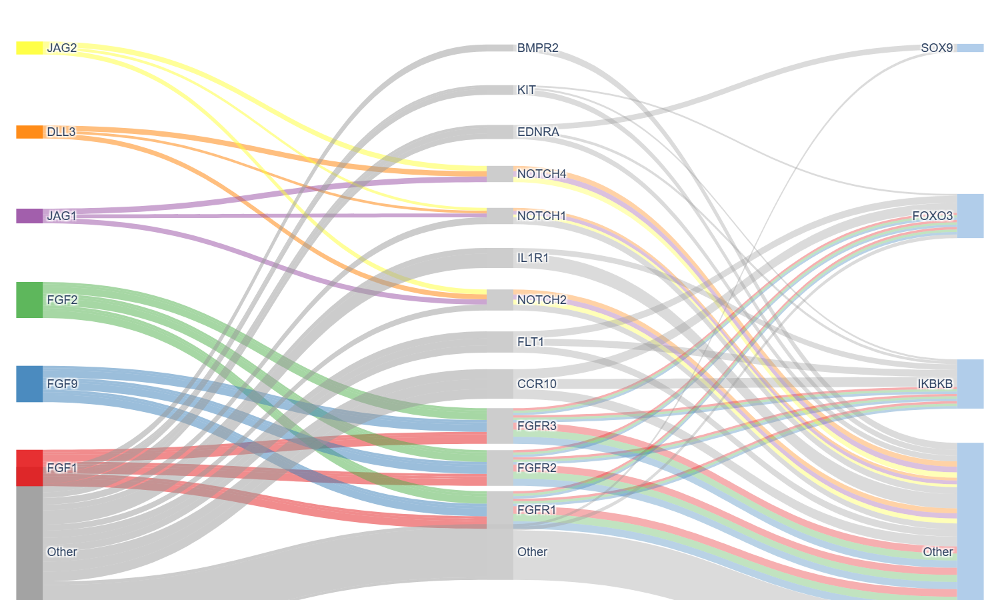
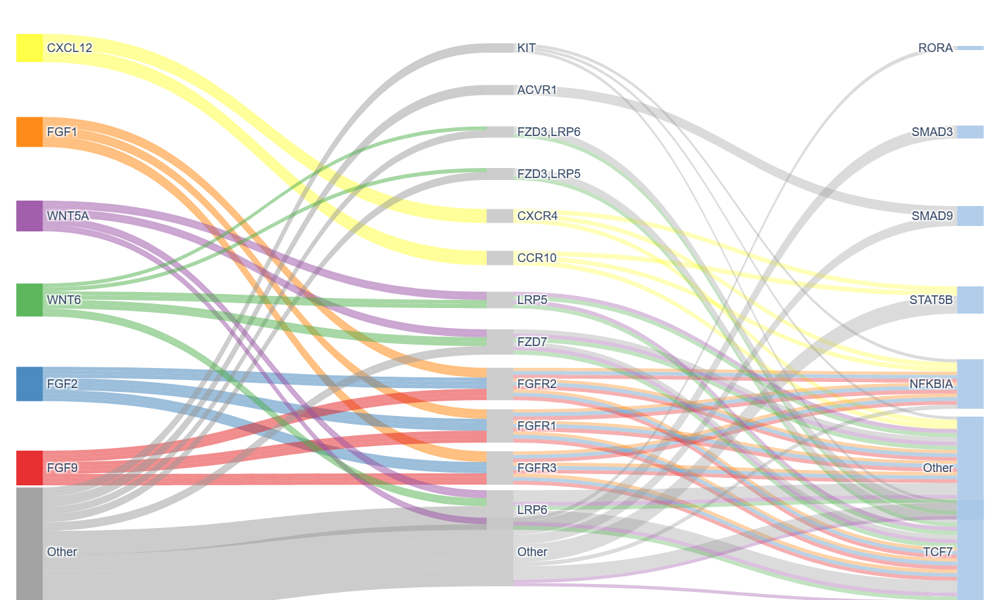
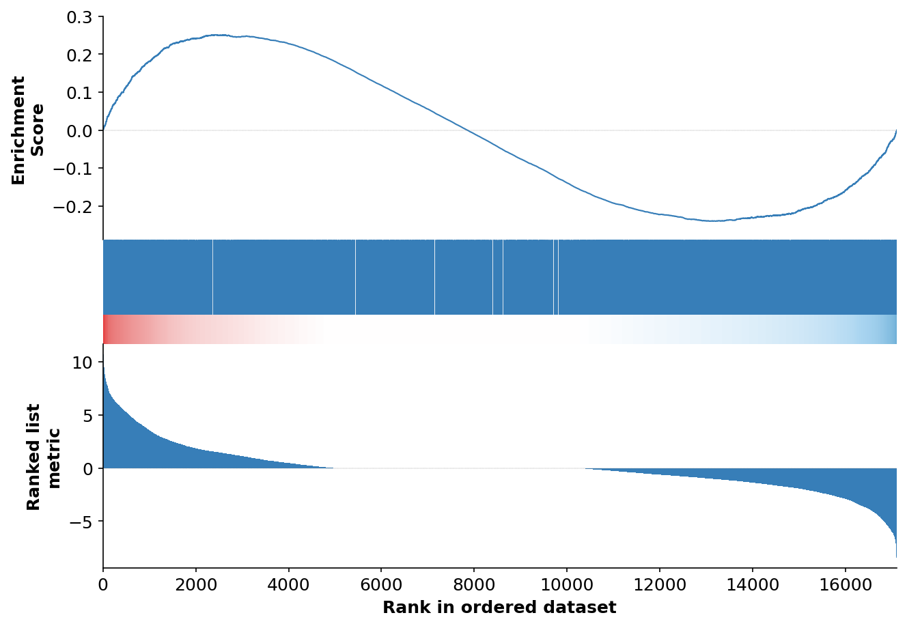
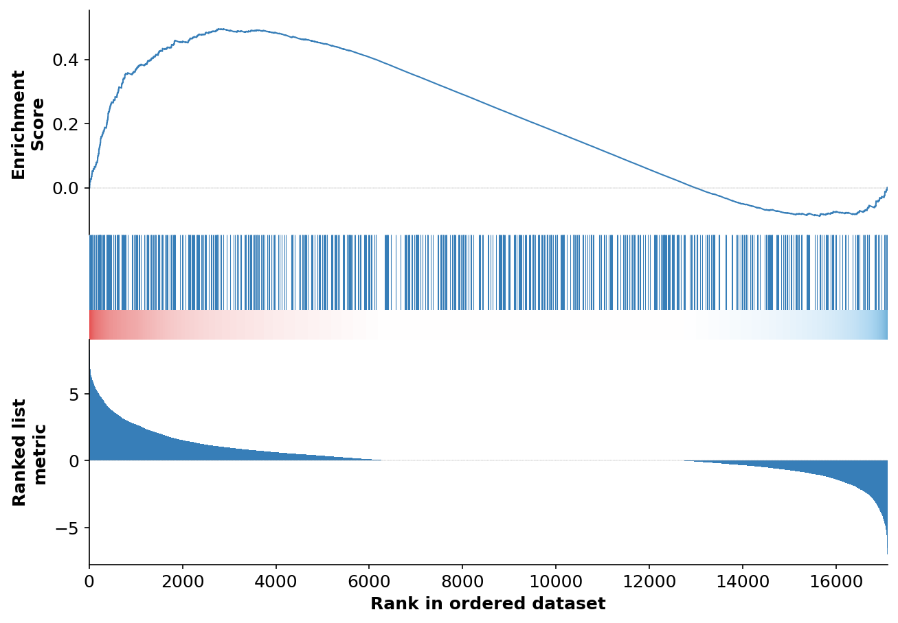
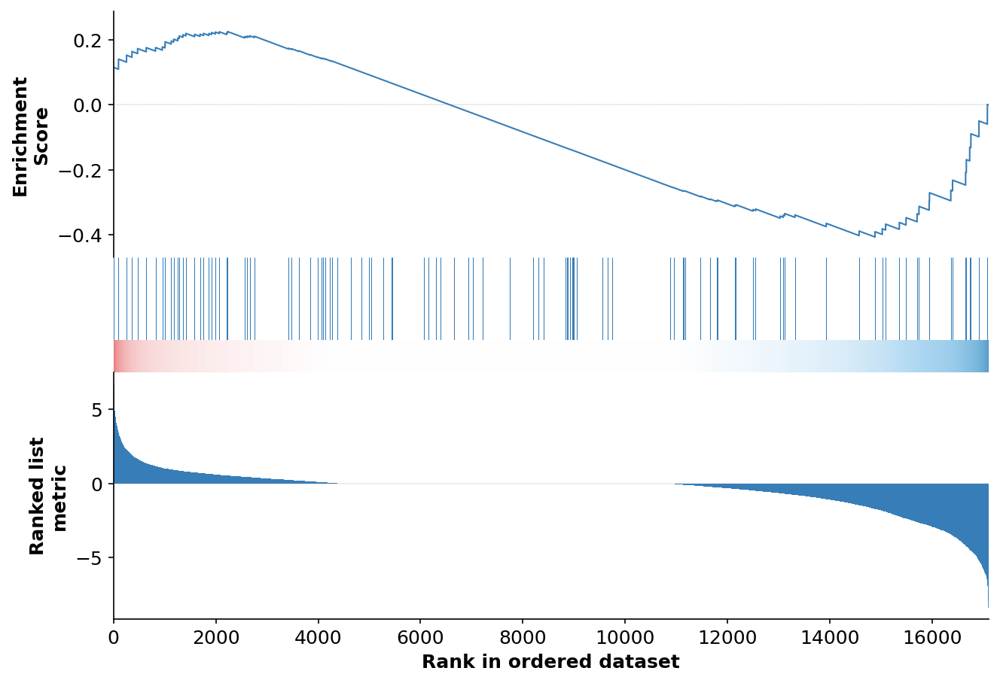
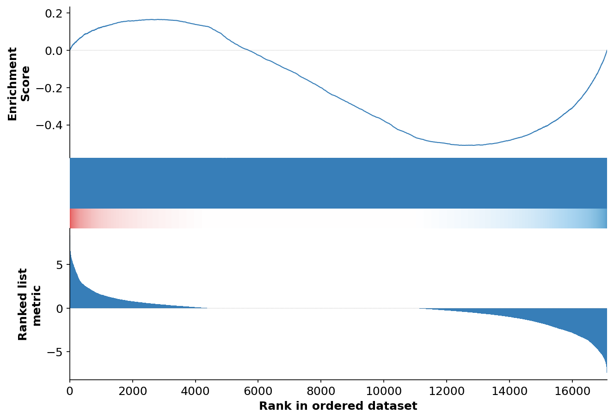
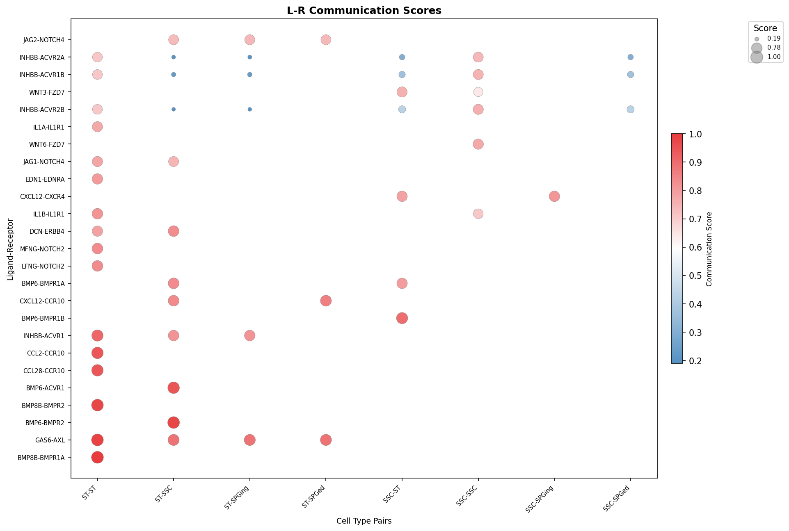
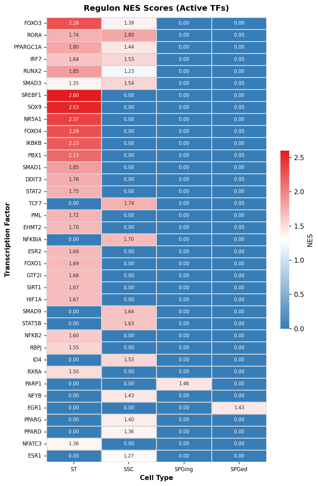

<p align="center">
   
</p>

<div align="center">

| | |
|---:|:---|
| **Package** | [](https://pypi.org/project/py-CellCall/) [](https://pypi.org/project/py-CellCall/) |
| **Meta** | [](LICENSE) [](https://github.com/omicverse/py-CellCall) |

</div>

---

# py-cellcall

Python port of [cellcall](https://github.com/ShellyCoder/cellcall): inference of intercellular and intracellular networks from single-cell transcriptomics.

## Features

- **Pure Python** — no R dependency
- **Fast** — 4.8x speedup over R (379s vs 1768s on 35K genes x 366 cells)
- **High parity** — Pearson >= 0.998 for expr_mean and expr_l_r_log2_scale
- **Compatible API** with R cellcall

## Install

```bash
pip install -e .
```

### Dependencies

```
numpy>=1.22, pandas>=1.4, scipy>=1.8, statsmodels>=0.13
```

## Quick Start

```python
import pandas as pd
from cellcall.connect_profile import create_nichcon_object, trans_commu_profile

# Load count matrix (genes x cells)
# Column names must encode cell type: "BARCODE_CELLTYPE"
data = pd.read_csv("counts.csv", index_col=0)

# Create CellInter object
obj = create_nichcon_object(
    data=data,
    source="UMI",        # "UMI", "fullLength", "TPM", "CPM"
    org="Homo sapiens",  # or "Mus musculus"
)

# Run communication analysis
obj = trans_commu_profile(
    obj,
    pValueCor=0.05,
    CorValue=0.1,
    topTargetCor=1,
    method="weighted",   # "weighted", "max", "mean"
    use_type="median",
    probs=0.75,
)

# Access results
scores = obj.data["expr_l_r_log2_scale"]  # Final scaled scores
regulons = obj.data["regulons_matrix"]     # TF regulon scores
means = obj.data["expr_mean"]             # Mean expression per cell type
```

## Function Map (R -> Python)

| R function | Python function |
|---|---|
| `CreateNichConObject()` | `create_nichcon_object()` |
| `TransCommuProfile()` | `trans_commu_profile()` |
| `ConnectProfile()` | `connect_profile()` |
| `LR2TF()` | `lr2tf()` |
| `getHyperPathway()` | `get_hyper_pathway()` |
| `trans2tripleScore()` | `trans2triple_score()` |
| `counts2normalized_10X()` | `counts2normalized_10x()` |
| `viewPheatmap()` | `view_pheatmap()` |
| `plotBubble()` | `plot_bubble()` |
| `getForBubble()` | `get_for_bubble()` |

## Output Slots

| Slot | Description |
|---|---|
| `expr_mean` | Mean expression per cell type |
| `regulons_matrix` | TF regulon NES scores |
| `fc_list` | Log2 fold changes per cell type |
| `expr_r_regulons` | L-R regulon activation scores |
| `softmax_ligand` | Softmax-normalized ligand expression |
| `softmax_receptor` | Softmax-normalized receptor expression |
| `expr_l_r` | Raw L-R communication scores |
| `expr_l_r_log2` | Log2-transformed scores |
| `expr_l_r_log2_scale` | Min-max scaled scores (0-1) |
| `DistanceKEGG` | KEGG pathway distances |

## Visualization

### Sankey Diagram (Ligand → Receptor → TF)

 

### GSEA Enrichment Plot

 

 

### L-R Communication & Regulon Heatmap

 

## Citation

If you use cellcall, please cite:

> Liu, T. et al. cellcall: integrated analysis of ligand-receptor and transcription factor activities from single-cell transcriptomics. (2021)
